# Desafio Sulwork

## Descrição

Esta aplicação organiza eventos de alimentação em uma empresa. Ela permite cadastrar eventos, colaboradores e inscrições, dividir os itens necessários por categoria, registrar contribuições e acompanhar quanto falta para atender cada necessidade.

O backend oferece uma API REST em Java. O frontend permite usar o fluxo pelo navegador, incluindo a consulta da cobertura, das restrições alimentares e da lista de itens que ainda faltam.

## Links

- Repositório: https://github.com/cicerooant/desafio-sulwork
- Aplicação publicada: https://desafio-sulwork-frontend.onrender.com
- Backend e API publicados: https://desafio-sulwork-backend.onrender.com
- Swagger publicado: https://desafio-sulwork-backend.onrender.com/swagger-ui/index.html
- Swagger local: http://localhost:18080/swagger-ui.html

## Tecnologias

### Backend

- Java 21.
- Maven 3.9.9, usado no Dockerfile do backend.
- Spring Boot 3.5.7.
- Spring Web, Spring Data JPA, Bean Validation, Flyway e PostgreSQL.
- springdoc OpenAPI 2.8.13.
- JUnit 5, Mockito e Testcontainers nas classes de teste.

### Frontend

- React 19.3.1.
- React DOM 19.3.1.
- Vite 8.3.6 declarado em `frontend/package.json`, com Tailwind CSS 3.4.19.
- React Router DOM 7.18.6, TanStack React Query 5.108.2 e React Hook Form 7.92.0.
- TypeScript 7.0.2 declarado em `frontend/package.json`.
- Vitest 5.1.1 e Testing Library para os testes.
- Nginx 1.27-alpine no Docker Compose local.

### Banco e infraestrutura

- PostgreSQL 17 Alpine.
- Docker Compose com três serviços: `postgres`, `backend` e `frontend`.
- Node.js 24 Alpine no build do frontend.
- Eclipse Temurin 21 JRE Alpine na imagem final do backend.

## Arquitetura

O projeto está dividido em `backend` e `frontend`. O backend usa a organização por funcionalidade e separa controller, service e repository em pacotes como `evento`, `participante`, `categoria`, `item`, `contribuicao` e `cobertura`. Os dados de entrada e saída são representados por DTOs Java, separados das entidades JPA.

O frontend está organizado em `src/features`, com áreas para eventos, participantes, organização de categorias e itens e colaboração. Os componentes usam React Query para carregar e atualizar dados da API.

```mermaid
flowchart TB
    subgraph Local[Docker Compose local]
        BrowserLocal[Navegador] -->|Frontend :4173| Nginx[Nginx]
        Nginx -->|/api e Swagger| BackendLocal[Backend Spring Boot :8080]
        BackendLocal -->|JPA e SQL| PostgresLocal[(PostgreSQL :5432)]
    end

    subgraph Desenvolvimento[Execução sem Docker]
        BrowserDev[Navegador] -->|Frontend :5173| Vite[Vite]
        Vite -->|proxy /api| BackendDev[Backend Spring Boot :8080]
        BackendDev -->|JPA e SQL| PostgresDev[(PostgreSQL local)]
    end

    subgraph Producao[Render]
        BrowserProd[Navegador] --> Static[Static Site React]
        Static -->|rewrite /api/*| BackendProd[Web Service com Docker]
        BackendProd -->|JDBC| PostgresProd[(Postgres gerenciado)]
    end
```



No Docker Compose local, o Nginx serve o frontend na porta 4173 e encaminha `/api`, `/v3/api-docs` e as rotas do Swagger para o backend. Sem Docker, o Vite encaminha `/api` para o backend local. No Render, o frontend é um Static Site e usa uma regra de rewrite de `/api/*` para o backend; não há Nginx nesse ambiente. O backend usa JPA/Hibernate sem DDL automático e aplica as migrações Flyway.

## Como executar

### Com Docker Compose

Na raiz do repositório:

```bash
docker compose up -d --build
```

O Compose cria:

- Frontend em http://localhost:4173.
- Backend em http://localhost:18080.
- PostgreSQL em `localhost:55432`, banco `alimentacao`.
- Swagger em http://localhost:18080/swagger-ui.html.

O backend do Compose usa as seguintes variáveis internas:

- `DB_URL=jdbc:postgresql://postgres:5432/alimentacao`
- `DB_USERNAME=alimentacao`
- `DB_PASSWORD=alimentacao`

O arquivo `.env.example` na raiz contém os valores padrão para executar o backend localmente contra um PostgreSQL em `localhost:5432`. Ele serve como modelo para as variáveis de ambiente do backend; Spring Boot não carrega esse arquivo automaticamente. Se o backend local for conectado ao banco iniciado pelo Compose, ajuste `DB_URL` para usar a porta publicada pelo Compose, `55432`.

Para encerrar:

```bash
docker compose down
```

Para remover também o volume do banco:

```bash
docker compose down -v
```

### Backend sem Docker

É necessário ter Java 21, Maven e PostgreSQL disponíveis.

Por padrão, `backend/src/main/resources/application.yml` tenta conectar em:

- `jdbc:postgresql://localhost:5432/alimentacao`
- Usuário `alimentacao`.
- Senha `alimentacao`.

Esses valores podem ser sobrescritos pelas variáveis `DB_URL`, `DB_USERNAME` e `DB_PASSWORD`.

Com Maven instalado e PostgreSQL disponível, carregue o modelo de ambiente e inicie o backend na raiz:

```bash
set -a
. ./.env.example
set +a
cd backend
mvn spring-boot:run
```

O `.env.example` documenta os nomes e valores locais. Se o PostgreSQL vier do Docker Compose, ajuste `DB_URL` para usar a porta de host `55432`.

O backend fica em http://localhost:8080 e o Swagger em http://localhost:8080/swagger-ui.html.

### Frontend sem Docker

É necessário ter Node.js disponível:

```bash
cd frontend
npm install
npm run dev
```

O Vite usa a porta padrão 5173. Em `frontend/vite.config.ts`, `/api` é encaminhado para `http://localhost:8080`.

## Publicação

A aplicação está publicada no Render. O banco é um Postgres gerenciado; o backend é um Web Service com Docker e diretório raiz `backend`; o frontend é um Static Site, compilado com `cd frontend && npm install && npm run build`, com `frontend/dist` como diretório publicado.

O Static Site encaminha `/api/*` para `https://desafio-sulwork-backend.onrender.com/api/*` e usa `/*` para servir `/index.html`, permitindo as rotas do frontend. O Nginx é usado apenas no Docker Compose local. O backend recebe `DB_URL`, `DB_USERNAME`, `DB_PASSWORD`, `SERVER_PORT=10000` e `JAVA_TOOL_OPTIONS=-XX:MaxRAMPercentage=65`; os valores de conexão do banco não são documentados aqui.

O plano gratuito do Render pode suspender o backend depois de cerca de 15 minutos sem uso. A primeira requisição depois da suspensão pode demorar cerca de um minuto, então a primeira abertura da aplicação também pode levar mais tempo. O banco gratuito foi criado em 22/11/2026 e expira 30 dias depois; a data exata deve ser conferida no painel do Render.

## Como executar os testes

### Backend

Na raiz do repositório, com Maven instalado e Docker disponível para os testes de integração:

```bash
mvn -f backend/pom.xml test
```

O `pom.xml` executa testes JUnit 5 com Mockito. Os testes de integração usam Testcontainers com PostgreSQL 17 Alpine e exigem um daemon Docker acessível. O Surefire configura `api.version=1.40` para compatibilidade com o Testcontainers.

### Frontend

Na pasta `frontend`:

```bash
npm test
```

Os testes usam Vitest e Testing Library. Para gerar a versão de produção:

```bash
npm run build
```

## Decisões e premissas

- As transições permitidas ficam no enum `StatusEvento`. RASCUNHO pode ir para ABERTO ou CANCELADO; ABERTO pode ir para ENCERRADO ou CANCELADO; ENCERRADO pode ir para REALIZADO ou CANCELADO. REALIZADO e CANCELADO são finais. Centralizei essa regra no enum para manter as transições explícitas em um só lugar.
- A API permite editar eventos em RASCUNHO e ABERTO, e excluir apenas em RASCUNHO. Em ABERTO, a atualização também exige que o prazo seja anterior à data do evento. Eventos encerrados, realizados ou cancelados ficam somente para leitura. Essa regra mantém o evento bloqueado depois das etapas em que há participação.
- A API confere o status e o horário atual a cada operação de contribuição, em vez de usar um job agendado. Escolhi essa abordagem porque a permissão depende do instante da requisição e não exige uma tarefa em segundo plano.
- O limite de contribuição é validado no service somando a quantidade do item com uma consulta SQL nativa. Na edição, a soma exclui a contribuição que está sendo alterada quando ela continua no mesmo item. Assim o limite considera o conjunto completo de contribuições sem contar a edição duas vezes.
- Categorias e itens podem ser criados, editados e excluídos em RASCUNHO; em ABERTO, isso só é permitido antes do prazo. Categoria com itens e item com contribuições não podem ser excluídos. A quantidade necessária não pode ser reduzida abaixo do total contribuído em ABERTO. Em RASCUNHO essa checagem não é necessária: o evento não volta a RASCUNHO, e inscrições e contribuições só podem ser criadas em ABERTO, portanto não há contribuições nesse estado.
- A inscrição e seu cancelamento exigem evento ABERTO antes do prazo. A constraint única do banco evita duas inscrições da mesma pessoa no mesmo evento. Não permiti cancelar inscrição com contribuição associada para preservar o vínculo entre contribuição e participante.
- O validador de CPF exige 11 dígitos, rejeita sequências com todos os dígitos iguais e confere os dois dígitos verificadores. Isso evita depender apenas de uma validação de formato.
- Padronizei as respostas de erro com `ProblemDetail` e `@RestControllerAdvice`, para manter um formato comum para erros da API.
- As alterações do banco são aplicadas por migrations Flyway incrementais. A V3 insere dados de exemplo para facilitar a verificação do fluxo.
- O backend não valida que prazo antecede a data ao criar evento nem ao atualizar evento em RASCUNHO. A validação está no formulário do frontend e na atualização de evento ABERTO. Essa divergência é mantida como limitação conhecida.

## Ambiguidades identificadas

- **O prazo substitui o status do evento?** Não. Resolvi tratar status e horário como condições separadas. A seção “Decisões e premissas” descreve quais operações verificam cada condição.
- **Em quais status uma inscrição é permitida?** O enunciado não define isso. Resolvi aplicar a regra operacional escolhida para inscrições, detalhada em “Decisões e premissas”.
- **O que acontece com dados de um evento cancelado?** A API não apaga inscrições nem contribuições ao mudar o status; os registros ficam no banco. Não implementei uma rotina automática de limpeza.
- **Como relacionar restrições alimentares a alérgenos?** O enunciado não fornece um mapeamento completo. Usei uma tabela explícita no código; os pares e níveis estão listados na seção “Restrições alimentares e alérgenos”.
- **Como combinar cobertura geral e por categoria?** O enunciado não fixa as fórmulas. Separei esses indicadores; as fórmulas e um exemplo estão na seção “Cálculo da cobertura”.
- **Uma inscrição com contribuição pode ser removida?** Não permiti deixar contribuições sem vínculo com uma inscrição; a regra aplicada está descrita em “Decisões e premissas”.

## Cálculo da cobertura

O item usa esta cobertura:

```text
itemCobertura = min(contribuído / necessário, 1)
```

Exemplo: um item necessita 10 unidades e recebeu 4. A cobertura do item é `4 / 10 = 0,4`, ou 40%. Se recebeu 12 para uma necessidade de 10, o valor fica limitado a `1`, ou 100%, embora as contribuições não possam ultrapassar 10 no fluxo normal.

A cobertura geral usa média ponderada entre os itens:

```text
soma(cobertura do item × peso do item) / soma(pesos dos itens)
```

Itens obrigatórios têm peso 2. Itens opcionais têm peso 1.

Exemplo numérico: um item obrigatório com cobertura 0,5 e um item opcional com cobertura 1 têm cobertura geral `(0,5 × 2 + 1 × 1) / (2 + 1) = 2 / 3`, aproximadamente 66,67%. Sem itens, o código devolve cobertura geral 0.

A categoria usa o total contribuído para seus itens dividido pela meta:

```text
categoriaCobertura = min(contribuídoDaCategoria / meta, 1)
```

Se a meta não existe, o código usa a soma das quantidades necessárias dos itens da categoria como base. A quantidade faltante da categoria é `meta - contribuído`, limitada a zero quando a contribuição ultrapassa a meta. Esta cobertura não entra na cobertura geral.

A API também separa os itens obrigatórios cuja quantidade faltante é maior que zero e lista os itens pendentes em `oQueFalta`.

A ordem de `oQueFalta` é: primeiro os obrigatórios, depois maior quantidade faltante, e por fim nome do item. No frontend, essa lista é exibida como “O que falta”.

## Restrições alimentares e alérgenos

Cada colaborador pode ter uma ou mais restrições. Cada item pode ter uma ou mais marcações de alérgeno. Os códigos são enums fixos no backend e são comparados diretamente por restrição e alérgeno.

A tabela real implementada é:

| Restrição | Alérgeno com conflito | Nível |
|---|---|---|
| SEM_GLUTEN | GLUTEN | ALTO |
| SEM_LACTOSE | LACTOSE | ALTO |
| SEM_LEITE | LEITE | ALTO |
| SEM_AMENDOIM | AMENDOIM | ALTO |
| SEM_CASTANHAS | CASTANHAS | ALTO |
| SEM_SOJA | SOJA | ALTO |
| SEM_OVO | OVO | ALTO |
| SEM_PEIXE | PEIXE | ALTO |
| SEM_CRUSTACEOS | CRUSTACEOS | ALTO |
| SEM_GERGELIM | GERGELIM | ALTO |
| VEGANO | LEITE, LACTOSE, OVO, PEIXE, CRUSTACEOS | MÉDIO |
| VEGETARIANO | PEIXE, CRUSTACEOS | MÉDIO |

Os conflitos aparecem na cobertura de cada item, com nome da pessoa, restrição, alérgeno e nível. O sistema não registra se um item contém carne, então não consegue identificar esse tipo de incompatibilidade. Vegetarianos são alertados apenas para PEIXE e CRUSTACEOS.

## Feature livre

A funcionalidade livre implementada é a lista `oQueFalta`. Ela resolve a dúvida prática sobre o que ainda precisa ser levado no evento, mostrando somente itens com quantidade faltante.

A lista usa obrigatoriedade como primeiro critério e quantidade faltante como segundo. Os itens obrigatórios aparecem antes dos opcionais e, dentro dessa ordem, os itens com maior quantidade faltante aparecem primeiro.

## Limitações e melhorias futuras

- O backend permite atualizar contribuições pela API, mas a tela atual do frontend cria e remove contribuições; não oferece edição da contribuição.
- O backend oferece endpoints de atualização para categorias e itens, mas o frontend atual cria e exclui esses registros sem tela de edição.
- O frontend não oferece telas completas de edição e exclusão de colaboradores, embora esses endpoints existam no backend.
- Não existe autenticação ou controle de perfil de usuário.
- Não existe job ou tarefa agendada para mudar status quando o prazo ou a data passam; as operações verificam o estado no momento da requisição.
- Não existe lista específica de carne nos alérgenos, por isso restrições vegetarianas têm cobertura limitada aos itens marcados como peixe ou crustáceos.
- O arquivo de exemplo V3 usa uma data fixa, que pode já ter passado quando o projeto for executado. Nesse caso, o evento seed não aceita inscrições ou contribuições, pois o prazo também é fixo.
- O frontend depende de um proxy na mesma origem: Nginx no Docker Compose local, proxy do Vite no desenvolvimento e rewrite do Static Site no Render.
- No plano gratuito do Render, o backend pode suspender após cerca de 15 minutos sem uso, e a primeira requisição depois da suspensão pode demorar cerca de um minuto.
- O banco gratuito do Render, criado em 22/11/2026, expira 30 dias depois. A data exata deve ser conferida no painel do Render.

## Uso de IA

- Ferramentas usadas: Copilot SDK no VS Code.
- Em quais etapas ajudaram: implementação e testes do backend, frontend, Docker Compose e documentação.
- Uma sugestão aceita: não há uma sugestão isolada registrada; as decisões técnicas seguiram o escopo e as regras que defini.
- Uma sugestão alterada ou rejeitada: não registrei uma sugestão específica alterada ou rejeitada; revisei os resultados e confirmei os comportamentos ao longo das etapas.
- Onde precisei de mais julgamento próprio: defini as regras de negócio, escolhi as ambiguidades a resolver e aprovei o avanço etapa por etapa.
